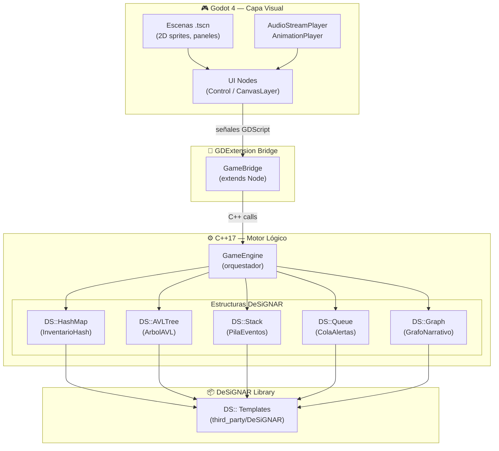
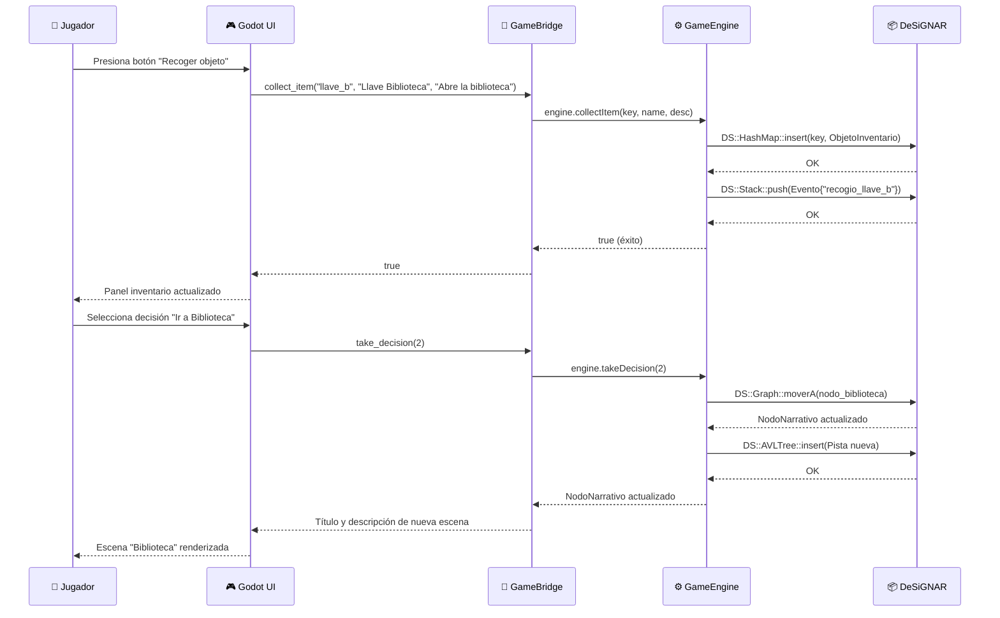

# Documento Técnico — Cold Case: La Mansión Blackwood

**Equipo:** Enigma Byte Studio | Programación 3  
**Versión:** 1.1.0  
**Fecha:** Noviembre 2026  

---

## 1. Arquitectura del Sistema

El proyecto adopta una arquitectura en capas donde la **lógica del juego** (C++17) está completamente desacoplada de la **capa visual** (Godot 4). La comunicación se realiza exclusivamente a través del puente GDExtension (`GameBridge`).



### Capas y responsabilidades

| Capa | Tecnología | Responsabilidad |
|------|-----------|-----------------|
| **Visual** | Godot 4.x | Renderizado 2D, UI, animaciones, audio |
| **Bridge** | GDExtension (godot-cpp) | Traducción de tipos Godot ↔ C++ |
| **Lógica** | C++17 (`GameEngine`) | Reglas del juego, narrativa, estado |
| **Datos** | DeSiGNAR (`DS::*`) | Estructuras de datos eficientes |
| **Build** | CMake 3.16+ | Compilación multiplataforma |

---

## 2. Características IMPLEMENTADAS

Las siguientes funcionalidades están completamente operativas en la versión actual (modo consola):

### Motor de Juego
- **`GameEngine`** — Orquestador central que coordina todas las estructuras y administra el estado del juego.
- **Lógica narrativa** con **7 escenas** conectadas: `[0] Entrada`, `[1] Vestíbulo`, `[2] Biblioteca`, `[3] Estudio`, `[4] Sótano`, `[5] Final Verdad`, `[6] Final Sellado`.
- **Dos finales posibles** determinados por la colección del ítem `grabacion`.

### Estructuras de Datos Propias (en producción)

| Clase | Tipo | Complejidad Clave |
|-------|------|-------------------|
| `InventarioHash` | Tabla Hash (djb2 + encadenamiento) | O(1) amortizado insertar/buscar/eliminar |
| `ArbolAVL` | Árbol AVL autobalanceado | O(log n) insertar/buscar, 4 rotaciones |
| `PilaEventos` | Pila LIFO (array circular) | O(1) push/pop/peek |
| `ColaAlertas` | Cola FIFO (`std::deque`) | O(1) enqueue/dequeue |
| `GrafoNarrativo` | Grafo dirigido + DFS/Backtracking | O(V+E) pathfinding |

### Tests Unitarios
- `test_inventario` — 8 casos: inserción, búsqueda O(1), colisiones, eliminación, desbordamiento.
- `test_avl` — 10 casos: inserción, 4 tipos de rotación, balanceo, búsqueda, inorden.
- `test_pila_cola` — 6 casos: push/pop LIFO, enqueue/dequeue FIFO, capacidad máxima.
- `test_grafo` — 7 casos: navegación, condiciones de aristas, DFS, backtracking.

### Build y Compilación
- `CMakeLists.txt` configurado con targets: `cold_case_consola`, `cold_case` (Qt6), 4 suites de test.
- Compilación verificada en **Windows** (MinGW / MSVC) y **Linux** (GCC 9+).
- **Modo consola funcional** al 100%: simulación completa de la partida, lógica de decisiones, inventario y resolución del caso.

---

## 3. Características PLANEADAS

### Migración a DeSiGNAR
- Reemplazar implementaciones propias por los templates de **DeSiGNAR** (`https://github.com/R3mmurd/DeSiGNAR`):
  - `InventarioHash` → `DS::HashMap<string, ObjetoInventario>`
  - `ArbolAVL` → `DS::AVLTree<Pista>`
  - `PilaEventos` → `DS::Stack<Evento>`
  - `ColaAlertas` → `DS::Queue<Evento>`
  - `GrafoNarrativo` → `DS::Graph<NodoNarrativo>`
- Integrar DeSiGNAR como submódulo en `third_party/DeSiGNAR`.
- Wrappers de compatibilidad en `include/structures/*Designar.hpp`.

### Capa Visual Godot 4
- Escenas `.tscn` con **sprites 2D** de personajes y habitaciones.
- Paneles UI: investigación (`InvestigacionPanel`), inventario (`InventarioPanel`), pistas (`PistasPanel`).
- Implementados con nodos `Control` / `CanvasLayer`.
- Escena principal: `main_scene.tscn` → gestiona transiciones.

### GDExtension Bridge
- Clase `GameBridge` (extiende `godot::Node`) compilada como `.dll` (Windows) / `.so` (Linux).
- Expone métodos a GDScript: `get_scene_title()`, `take_decision(id)`, `collect_item()`, `get_inventory()`, `get_clues()`, `is_game_over()`.
- Archivo `gdextension/cold_case.gdextension` para registro en Godot.

### Audio y Animaciones
- Música de ambiente y efectos de sonido integrados en Godot.
- `AnimationPlayer` para transiciones de escena y eventos narrativos.
- Pantalla splash con logo de **Enigma Byte Studio**.

### Build Sistema GDExtension
- Target CMake `cold_case_gdextension` que genera `.dll`/`.so`.
- Integración con `godot-cpp` (submódulo en `third_party/godot-cpp`).
- Soporte multiplataforma vía `SConstruct` o `CMakeLists.txt` extendido.

---

## 4. Flujo de Datos

El flujo de datos en tiempo de ejecución sigue una dirección clara: de la UI de Godot hacia las estructuras de DeSiGNAR, pasando por el puente y el motor.



---

## 5. Tablero Kanban (Trello)

| 📌 Notes | 📋 To-Do | 🔄 InProgress | 🧪 Testing | ✅ Done |
|----------|----------|---------------|------------|---------|
| Animaciones y transiciones Godot | Escenas Godot (.tscn) — sprites 2D | Migración estructuras → DeSiGNAR | CMakeLists.txt actualizado (DeSiGNAR + godot-cpp) | ✅ Modo consola funcional |
| Audio ambiente + SFX | GDExtension bridge (GameBridge .dll/.so) | | | ✅ GameEngine (orquestador) |
| Pantalla splash Enigma Byte Studio | Paneles UI: investigación, inventario, pistas | | | ✅ InventarioHash (tabla hash djb2) |
| Optimización DeSiGNAR vs. propias | Build sistema: SConstruct / CMake para .dll | | | ✅ ArbolAVL (4 rotaciones) |
| | Pantalla de créditos | | | ✅ PilaEventos (LIFO) |
| | | | | ✅ ColaAlertas (FIFO) |
| | | | | ✅ GrafoNarrativo (DFS + Backtracking) |
| | | | | ✅ Lógica narrativa 7 escenas + 2 finales |
| | | | | ✅ test_inventario (8 casos) |
| | | | | ✅ test_avl (10 casos) |
| | | | | ✅ test_pila_cola (6 casos) |
| | | | | ✅ test_grafo (7 casos) |

---

## 6. GitFlow

El proyecto sigue el modelo **GitFlow** con las siguientes ramas:

| Rama | Tipo | Propósito |
|------|------|-----------|
| `main` | Producción | Código estable y probado. Solo recibe merges desde `release/*` o `hotfix/*`. |
| `develop` | Integración | Rama base de desarrollo. Todas las features se fusionan aquí antes de release. |
| `feature/kanban-gitflow-setup` | Feature | Configuración inicial del repositorio: GitFlow, Trello, estructura de proyecto. |
| `feature/designar-migration` | Feature | Migración de estructuras propias a templates de DeSiGNAR. |
| `feature/godot-scenes` | Feature | Creación de escenas `.tscn`, sprites 2D y paneles UI en Godot 4. |
| `feature/gdextension-bridge` | Feature | Implementación de `GameBridge` como GDExtension (`.dll`/`.so`). |
| `feature/cmake-designar-godot` | Feature | Actualización de `CMakeLists.txt` para incluir DeSiGNAR + godot-cpp. |
| `feature/game-logic-cpp` | Feature | Lógica de juego en C++: GameEngine, escenas, decisiones y finales. |
| `feature/technical-doc` | Feature | Documentación técnica del proyecto (este documento). |
| `feature/readme-final` | Feature | README.md final con stack actualizado y guías de compilación. |

### Convención de commits

```
feat:  nueva funcionalidad
fix:   corrección de bug
docs:  documentación únicamente
test:  adición o modificación de tests
refactor: refactorización sin cambio funcional
chore: tareas de build, CI, dependencias
```

---

## 7. Stack Tecnológico

| Componente | Tecnología | Versión Mínima | Rol en el Proyecto |
|------------|-----------|----------------|-------------------|
| **Lenguaje Principal** | C++17 | GCC 9+ / Clang 10+ / MSVC 2019+ | Motor lógico, estructuras, GameEngine |
| **Estructuras de Datos** | [DeSiGNAR](https://github.com/R3mmurd/DeSiGNAR) | Última estable | Templates DS::HashMap, AVLTree, Stack, Queue, Graph |
| **Motor Gráfico** | Godot 4.x | 4.0+ | Renderizado 2D, UI, audio, animaciones |
| **GDExtension API** | godot-cpp | 4.x (submódulo) | Bridge C++ ↔ Godot (GameBridge.dll/.so) |
| **Build System** | CMake | 3.16+ | Compilación multiplataforma |
| **Control de Versiones** | Git + GitHub | — | Gestión de código, GitFlow, PRs |
| **Testing** | Executables + assert | C++17 STL | 4 suites de prueba unitaria |
| **GUI (legado)** | Qt6 Core + Widgets | 6.0+ | UI alternativa (en desuso, reemplazada por Godot) |

---

*Documento generado por Enigma Byte Studio — Programación 3 | Noviembre 2026*